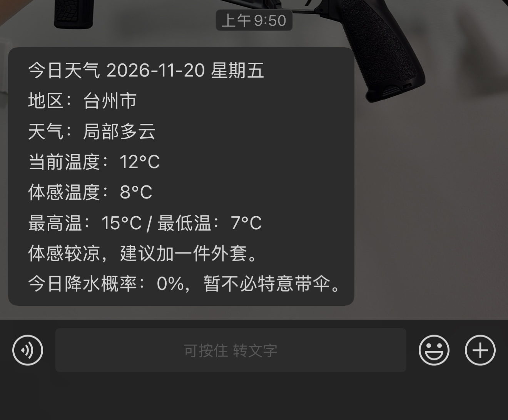
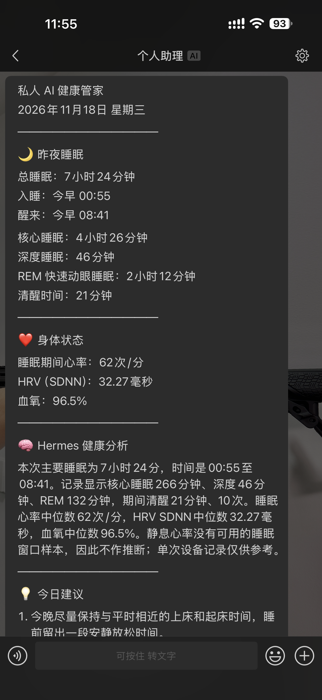

# Apple Health AI Bridge

> 首版 v0.1.0。使用前请阅读下方安装顺序和已知限制。

Apple Health AI Bridge 将 iPhone 上的 Apple Shortcuts、iCloud Drive 和 Mac 上的 Hermes Agent 连接起来，让天气与健康数据在个人设备及授权同步环境内处理，并由 Hermes 生成或发送晨报。

天气快捷指令 `Hermes Weather Morning Independent v3.3.1` 已在作者 iPhone 真机运行验证。健康快捷指令从 iCloud Drive 提供的签名文件制作了独立发布副本；Mac 上已安装同名主快捷指令，但无法从当前安装项导出载荷逐字节核对，因此不能声称已证明两者完全一致。请勿将项目里的测试夹具当作真实健康输入。

English overview: [README_EN.md](README_EN.md)

## 下载与项目内容

- 健康主快捷指令：[Health Morning Independent.shortcut](shortcuts/Health%20Morning%20Independent.shortcut)，以及必需的 B1 子快捷指令：[Apple Health Export v3.3 Stage B1 Auto Core.shortcut](shortcuts/Apple%20Health%20Export%20v3.3%20Stage%20B1%20Auto%20Core.shortcut)
- 天气快捷指令：[Weather Morning Independent.shortcut](shortcuts/Weather%20Morning%20Independent.shortcut)，来源为已验证的 v3.3.1。
- Mac 接收器、导入、报告处理、天气 reader 与隔离测试：[mac/](mac/)
- 安装、配置、iCloud、Hermes、微信、安全与排障文档：[docs/](docs/)
- AI 安装提示词：[prompts/AI_INSTALL_PROMPT.md](prompts/AI_INSTALL_PROMPT.md)
- 天气和健康样例均为合成数据：[examples/](examples/)

健康快捷指令来源、审计范围与版本确认限制记录在[配置说明](docs/CONFIGURATION.md)和[发布审计](docs/PUBLISHING_AUDIT.md)。B1 是健康主快捷指令调用的依赖，安装健康流程时也必须导入。

## 架构

```text
Apple Watch
    |
Apple Health
    |
    v
  iPhone
    |
Apple Shortcuts
    +---- 健康数据采集
    +---- Apple 天气采集
    |
    v
JSON 文件
    |
    v
iCloud Drive
    |
    v
Mac 本地接收器
    +---- Health Worker ----> 本地事实整理 ----> Hermes AI 分析
    |
    +---- Weather Worker ---> 天气验证、单位转换与消息生成
    |
    v
本机 self-only iLink sender
（读取 Hermes Weixin 本地状态）
    |
    v
用户个人微信
```

Hermes 部署在 Mac 上，iPhone 不运行 Hermes。iPhone 和 Mac 通过 iCloud Drive 同步 JSON。天气与健康有独立 reader、worker、outbox 和每日去重。健康分析由 Hermes 执行，天气原始值由 Mac 确定性转换。当前候选 sender 由 receiver 进程直接调用 iLink，复用本机 Hermes Weixin 状态；消息发送本身不是 Hermes Agent 的工具调用。

发送适配依赖用户自己的本机 Hermes Weixin 状态，跨版本兼容性尚未验证。

## 使用条件

- 支持当前 Hermes 官方安装方式的 Mac。Hermes 官方文档列出的 macOS 桌面包仅支持 Apple Silicon；其他安装路径请以官方平台说明为准。
- iPhone 与 Mac 使用同一 Apple 账户并启用 iCloud Drive。
- Hermes Agent 已配置模型与 Weixin 通道。
- Node.js 20 或更高版本，Python 3。
- iPhone 上导入快捷指令、授权健康/定位/iCloud，并由用户创建所需的个人自动化。

快捷指令文件已经随候选提供。安装健康流程时先导入 B1，再导入健康主快捷指令；天气快捷指令单独导入。它们尚未由新用户 iPhone 重新导入验收，因此完整端到端安装暂不可宣称完成。

## 快速检查

```sh
npm test
```

该命令只运行隔离单元测试，不连接真实健康数据、iCloud、Hermes 或微信。它不代表新设备的端到端验收。

## 安装文档

- [安装与验收](docs/INSTALL.md)
- [配置与快捷指令状态](docs/CONFIGURATION.md)
- [Hermes](docs/HERMES.md)
- [Hermes 官方微信配置指南](https://hermes-agent.nousresearch.com/docs/user-guide/messaging/weixin)
- [iCloud Drive](docs/ICLOUD.md)
- [安全与隐私](docs/SECURITY.md)
- [故障排查与限制](docs/TROUBLESHOOTING.md)
- [许可证范围说明](docs/LICENSING.md)

## 真机验证状态

作者的天气 v3.3.1 已验证：读取天气、生成固定名称天气 JSON，并完成 iCloud 到 Mac 的生产链路。候选包中的文件来自该签名版本的只读副本，任何脱敏改动均未施加在快捷指令上。

健康快捷指令副本未经本轮 iPhone 重新导入验证；健康采集、候选版跨用户部署以及端到端微信发送都需要分别验证。测试通过不代表这些环节已完成。

## 许可证

本项目采用个人非商业专用许可证：个人可免费使用、修改并免费再分发，修改版须保留署名、出处并遵守相同限制；商业使用、收费部署和商业运营须事先取得书面授权。详细条款见 [LICENSE](LICENSE) 和[许可证说明](docs/LICENSING.md)。本项目为源码公开项目，不是 OSI 批准的开源许可证项目。

## 已知限制

- iCloud Drive 同步会延迟；文件在 Finder 可见不代表内容已完整物化。
- 天气 reader 与健康导入器包含稳定读取、内容校验和重试，但不能消除 Apple File Provider 或网络层故障。
- 健康旧文件曾遇到 `ENOENT` 重试；新设备需验证其授权和目录。
- 天气 shortcut 真机验证仅代表作者当前设备/系统组合。
- 微信发送适配依赖 Hermes 本机私有状态格式，尚未完成跨版本兼容审计。
- Hermes 以外的 Agent、其他 iPhone 机型、时区和地区尚未完成同等程度真实验收。
- 当前安装中的健康快捷指令无法从 Shortcuts 导出作逐字节比对；候选健康副本未经新用户 iPhone 真机导入验收。

## 真实微信推送效果

下方是项目作者提供的天气早报和健康早报实际发送到微信后的截图，用于展示一次真实运行的消息排版和内容结构，不代表所有用户安装后的结果都会完全相同。按作者要求，截图画面内容未遮挡；图片文件元数据已移除。健康图中可见的日期、睡眠和生理指标，以及天气图中的日期、地区和天气数值均按作者要求保留。

| 天气早报实际推送 | 健康早报实际推送 |
| --- | --- |
|  |  |

图片来源、处理方式和公开内容说明见[真实推送截图审查记录](docs/SCREENSHOT_PRIVACY.md)。

## 联系作者与自愿支持

个人非商业使用免费。商业使用需事先取得作者授权；请通过下方「联系作者」二维码咨询。

<table>
  <tr>
    <td align="center" valign="top">
      <strong>联系作者</strong><br />
      技术交流、联系作者及商业授权咨询<br />
      
    </td>
    <td align="center" valign="top">
      <strong>自愿打赏</strong><br />
      项目免费使用，打赏完全自愿<br />
      
    </td>
  </tr>
</table>

打赏不构成商业授权，也不是使用本项目的前提。当前许可范围及其限制见[许可证说明](docs/LICENSING.md)。
