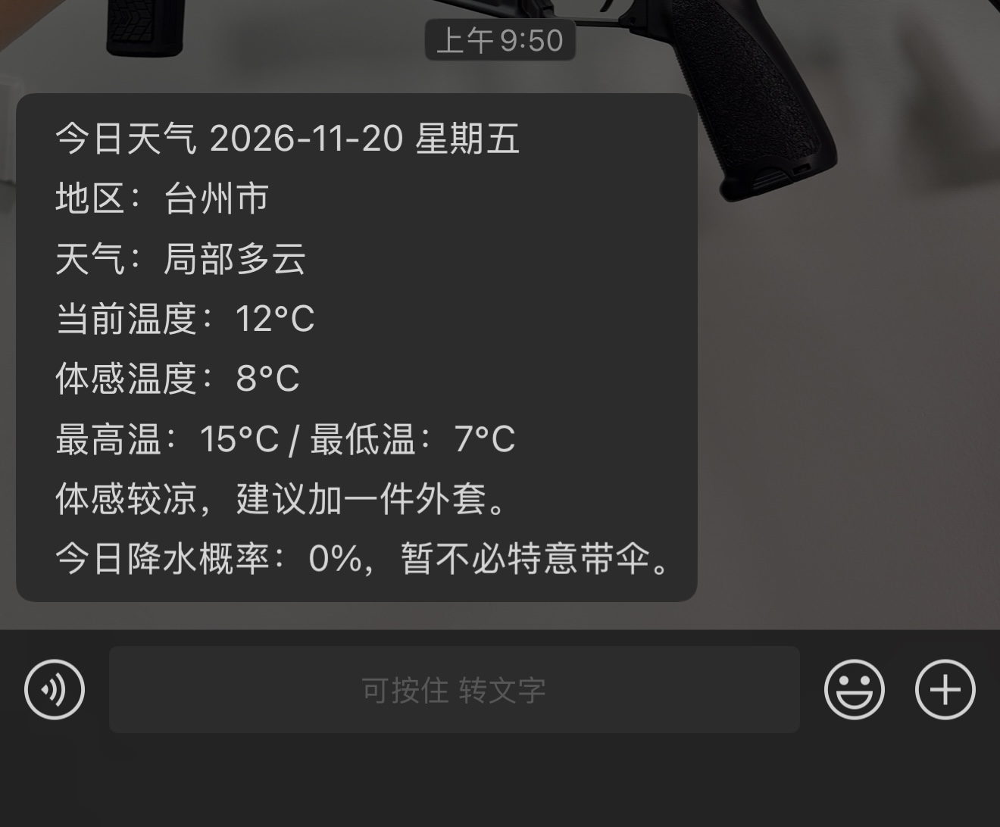
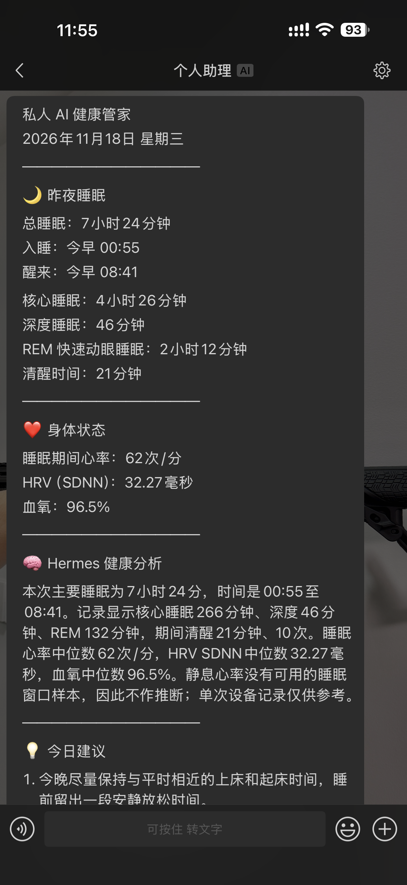

# Apple Health AI Bridge

The v0.1.0 release contains signed copies of the Health main shortcut, its required B1 child shortcut, and the verified v3.3.1 weather shortcut. The installed Health shortcut could not be exported from Shortcuts for byte-for-byte comparison, and the release Health copy has not been reimported on an iPhone for this release.

The project connects Apple Shortcuts on iPhone, iCloud Drive, a Mac receiver, and Hermes Agent. Health and weather use separate workers and daily delivery ledgers. Personal data should remain on the user's devices and explicitly authorized sync/storage services.

## Status

- Weather Shortcut `Hermes Weather Morning Independent v3.3.1` was tested on the author's iPhone and produced a fixed-name JSON file.
- The Health main shortcut calls `Apple Health Export v3.3 Stage B1 Auto Core`; import B1 before the Health main shortcut. A same-named Health shortcut is installed on the Mac, but its installed payload could not be exported for byte-for-byte comparison.
- Mac receiver isolation tests pass in this candidate; they do not prove deployment on another user's Mac.
- The sender adapter reads local Hermes Weixin state and uses the iLink protocol. It is not a generic public Hermes messaging SDK and still needs cross-installation verification.
- No real health JSON, production logs, outbox, tokens, account IDs, or private repository history are included.

See [the Chinese README](README.md), [installation](docs/INSTALL.md), [configuration](docs/CONFIGURATION.md), [Hermes](docs/HERMES.md), the [official Hermes Weixin guide](https://hermes-agent.nousresearch.com/docs/user-guide/messaging/weixin), [iCloud](docs/ICLOUD.md), and [security](docs/SECURITY.md).

## Real WeChat Delivery Screenshots

These author-provided screenshots show actual weather and health reports delivered to WeChat. They demonstrate one real run's message layout and content structure and do not guarantee identical results for every installation. At the author's direction, screenshot contents are unredacted; image metadata has been removed. The visible date, location, weather values, sleep information, and health metrics are retained.

| Actual weather report | Actual health report |
| --- | --- |
|  |  |

See the [screenshot review record](docs/SCREENSHOT_PRIVACY.md) for source and processing details.

## License

This project uses a personal non-commercial license: individuals may use, modify, and redistribute it free of charge for personal purposes, with attribution and the same restrictions. Commercial use, paid deployment, and commercial operation require prior written permission. See [LICENSE](LICENSE) and [LICENSING.md](docs/LICENSING.md). The project is source-available, not OSI-approved open-source software.

Author contact and voluntary-support QR codes are provided by the author. Donations are voluntary and do not grant commercial rights.
